# 📚 BookNest — Online Book Rental & Library Management System

<div align="center">

[](https://laravel.com)
[](https://php.net)
[](https://sqlite.org)
[](https://getbootstrap.com)
[](https://stripe.com)
[](LICENSE)

<br/>

**A full-featured, enterprise-ready web application for online book rentals, tiered membership subscriptions, automated overdue fine calculation, book reservations, and Stripe payment processing.**

[Key Features](#-key-features) •
[UI Screenshots](#-user-interface--screenshots-gallery) •
[Architecture](#-system-architecture--data-model) •
[Project Structure](#-project-directory-structure) •
[Installation & Quickstart](#-installation--quickstart-guide) •
[Background Automation](#-background-automation-commands)

</div>

---

## 📌 Executive Summary

**BookNest** bridges the gap between traditional libraries and modern digital subscription platforms. Designed with a dual-interface architecture, it provides an intuitive reading hub for readers and a command center for administrators. 

Whether tracking real-time book availability, handling multi-tier subscriptions, queueing reservation waitlists, calculating daily late fines automatically via Artisan schedulers, or exporting comprehensive Excel financial reports, **BookNest** delivers a fast, secure, and production-grade solution.

---

## 📸 User Interface & Screenshots Gallery

### 1. Reader Book Catalog & Discovery
Interactive book catalog featuring real-time stock counters, cover previews, author details, and instant rent/reserve triggers.
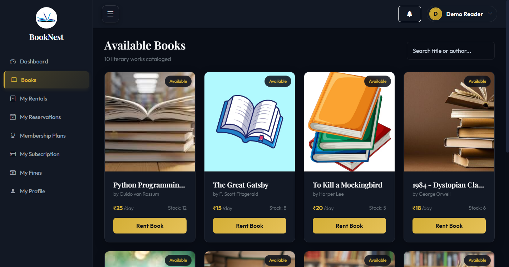

---

### 2. Admin Executive Analytics Dashboard
Central control tower displaying real-time platform statistics: total revenue, active checkouts, overdue titles, member distribution, and system logs.
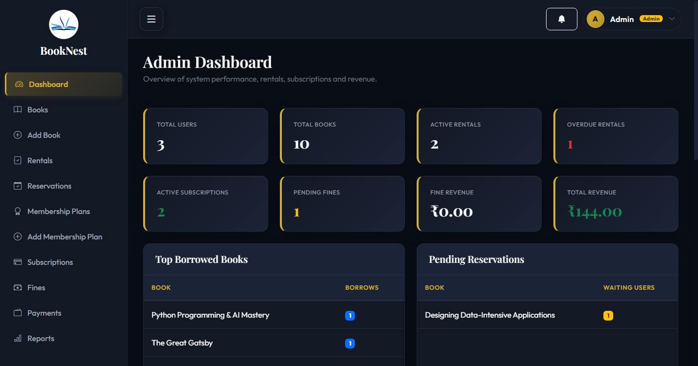

---

### 3. Reader Borrowing & Rental Management
Dedicated reader dashboard tracking active rentals, due dates, return statuses, and overdue notices.
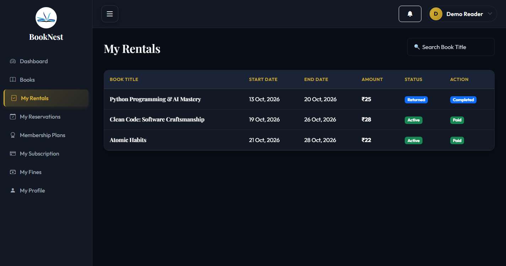

---

### 4. Admin Book Inventory Management
Full CRUD inventory portal powered by DataTables with dynamic search, pagination, stock adjustments, and instant status toggling.
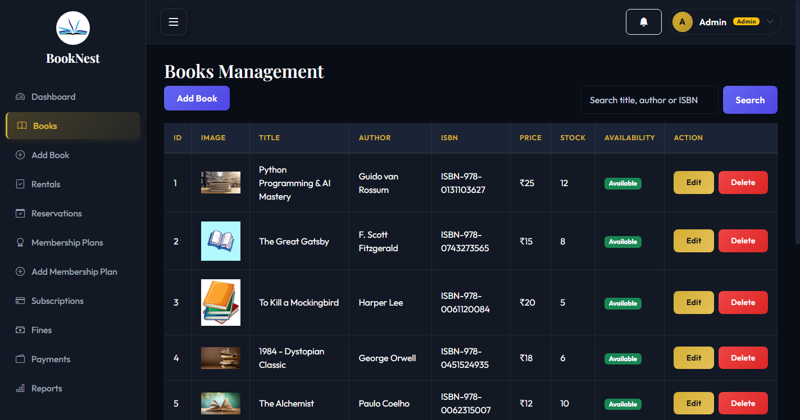

---

### 5. Multi-Tier Membership Subscriptions
Subscription tier showcase (Silver, Gold, Platinum) with dynamic borrowing quotas, return windows, and integrated Stripe Checkout.
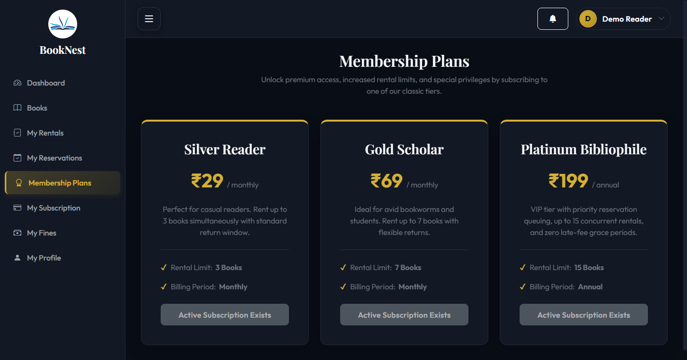

---

### 6. Rental Lifecycle & Overdue Return Tracking
Comprehensive administrative control over checkouts, extensions, returns, and calculated penalty fines.
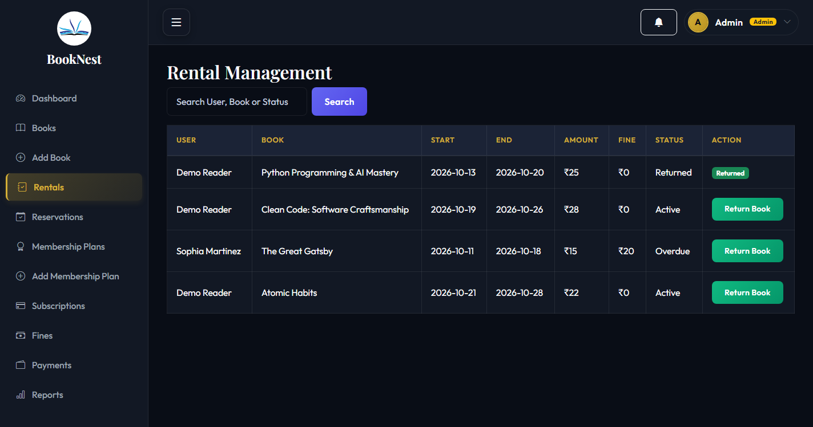

---

### 7. Stripe Payments & Financial Ledger
Complete transaction history capturing checkout session IDs, membership purchases, rental deposits, and fine settlements.
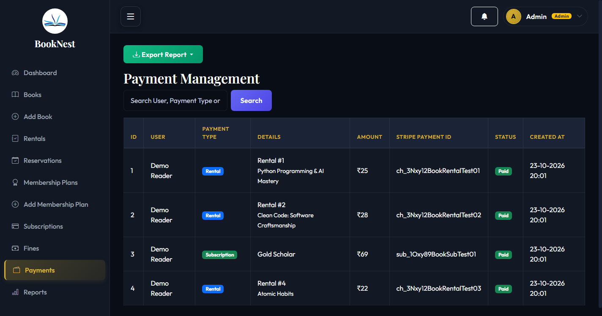

---

### 8. Automated Overdue Fine Tracking
Real-time tracking of late book returns with automated per-diem fine calculations and 1-click status updates.
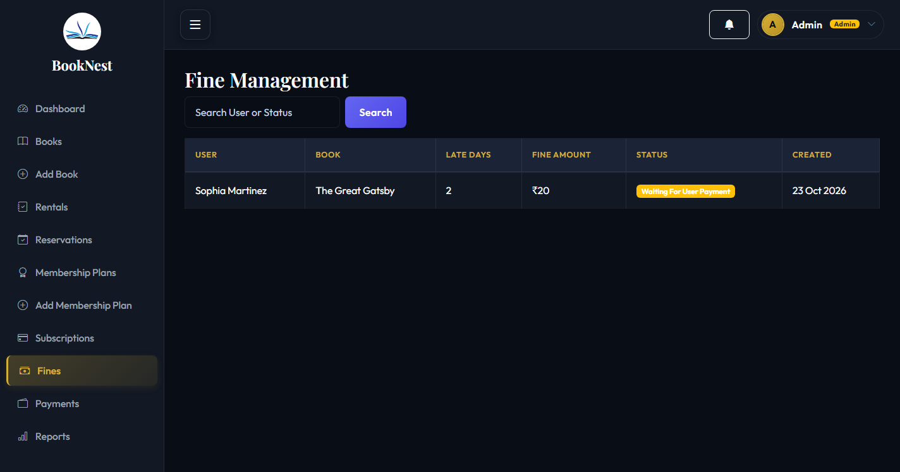

---

### 9. Book Reservation Queue
Queue-based reservation system allowing readers to reserve checked-out titles with automated fulfillment upon book returns.
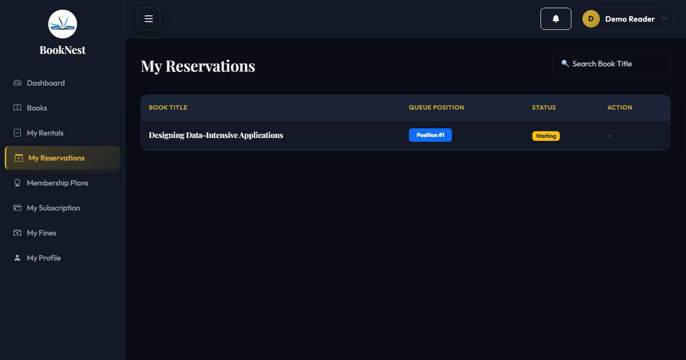

---

### 10. Operational Reports & Data Export Engine
One-click export of platform records (Rentals, Subscriptions, Fines, Payments) to `.xlsx` and `.csv` via Laravel Excel.
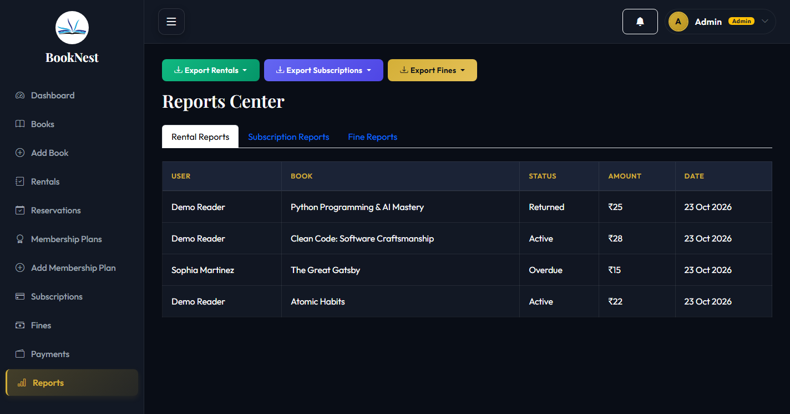

---

### 11. Split-Screen Branded Authentication
Custom split-screen authentication interface featuring secure session handling and password visibility toggles.
| Sign In Portal | Reader Registration |
| :---: | :---: |
| 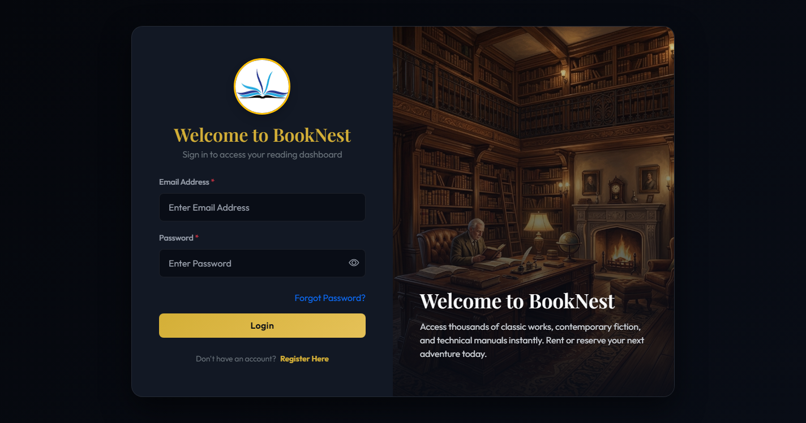 | 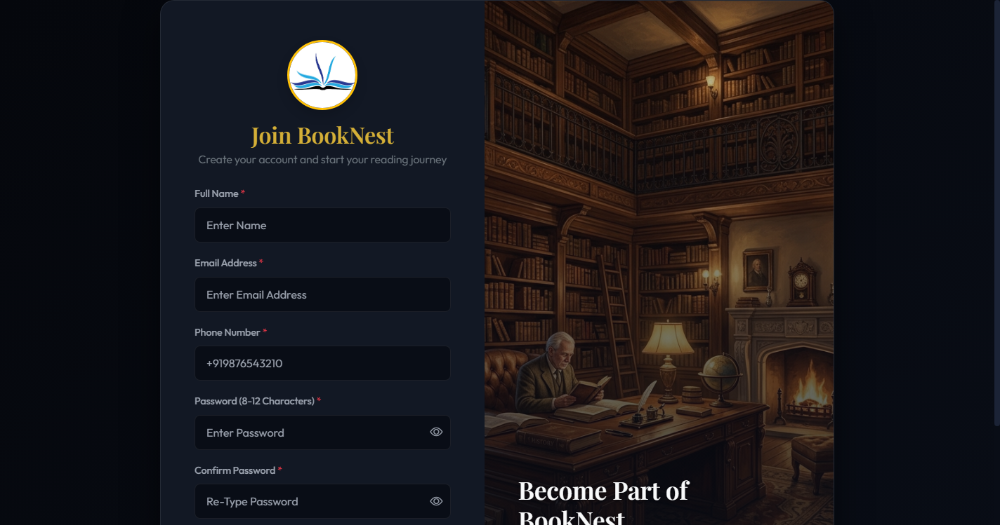 |

---

## ✨ Key Features

### 👤 Reader Experience
- 🔍 **Interactive Catalog:** Search, filter, and discover books by title, author, or ISBN with live stock status badges.
- 📖 **1-Click Book Rentals:** Rent books instantly with dynamic due-date calculations based on user membership tier.
- ⏳ **Queue-Based Reservations:** Reserve out-of-stock books; get automatically notified when copies are returned.
- 💳 **Stripe Checkout Integration:** Seamlessly purchase subscriptions, rental fees, and overdue fines using secure Stripe payment forms.
- 🏅 **Tiered Memberships:** Choose between **Silver Reader**, **Gold Scholar**, and **Platinum Bibliophile** for higher rental allowances and extended loan periods.
- 🔔 **Activity & Alerts:** Real-time reminders for upcoming return deadlines and available reserved books.

### 🛡️ Administrator Command Center
- 📊 **Metric Analytics:** Live counters for active rentals, total revenue, overdue accounts, and active subscriptions.
- 📚 **Inventory Management (CRUD):** Add, update, delete, and adjust cover art, rental prices, and stock for all books.
- 🔄 **Rental Lifecycle Management:** Check out, monitor overdue loans, process returns, and log returned condition.
- 💰 **Automated Fine Engine:** Configure per-day late fees; automate fine calculations via background Artisan schedulers.
- 📑 **Excel & CSV Export Engine:** Export complete datasets for Rentals, Payments, Subscriptions, and Fines with date filters.
- 🔒 **Role-Based Access Control (RBAC):** Strict middleware protecting administrative routes from regular user access.
- 🛡️ **Audit Logging:** Built-in activity logging recording administrative changes, IP addresses, and timestamps.

---

## 🛠️ Technology Stack Matrix

| Layer | Technologies / Packages | Purpose |
| :--- | :--- | :--- |
| **Backend Framework** | [Laravel 11.x](https://laravel.com) (PHP 8.2+) | MVC Architecture, Routing, Middleware, Artisan CLI |
| **Database & ORM** | SQLite (Default Dev) / MySQL 8.0+, Eloquent ORM | Relational data persistence, schema migrations, seeders |
| **Frontend UI** | Blade Templates, HTML5, CSS3, JavaScript | Server-rendered modern responsive interfaces |
| **Styling & Icons** | Bootstrap 5.3, Bootstrap Icons, Custom CSS | Cyber/modern split views, data cards, modals, themes |
| **Data Tables** | jQuery DataTables (`yajra/laravel-datatables-oracle`) | Real-time sorting, search, and pagination on inventory tables |
| **Payment Gateway** | [Stripe PHP SDK](https://stripe.com) (`stripe/stripe-php`) | Secure hosted checkout sessions for rentals, plans, and fines |
| **Export Engine** | [Laravel Excel](https://maatwebsite.nl) (`maatwebsite/excel`) | High-speed `.xlsx` and `.csv` spreadsheet generation |
| **Date Time Picker** | Flatpickr | Date selection for rental calendars and report date-range filters |
| **Automation** | Laravel Task Scheduler & Custom Artisan Commands | Overdue fine calculation and expired reservation cleanup |

---

## 🗄️ System Architecture & Data Model

### Architecture Overview

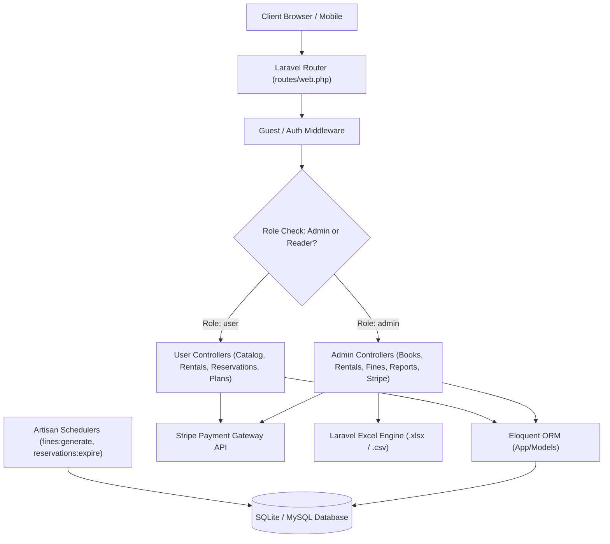

### Entity Relationship Diagram (ERD)

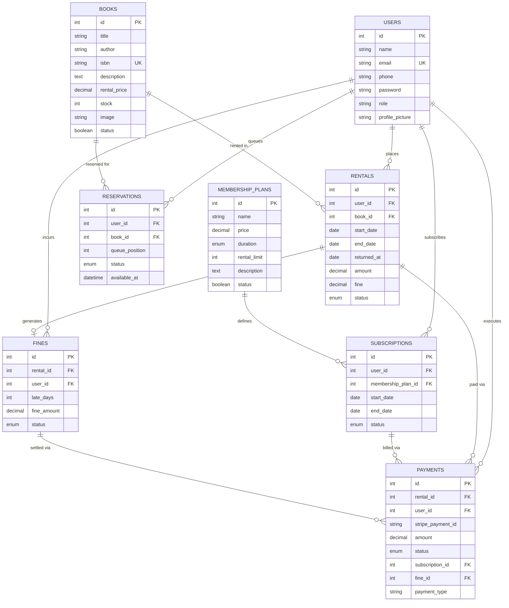

---

## 📁 Project Directory Structure

```plaintext
book-rental-system/
├── app/
│   ├── Console/Commands/              # Automated Artisan commands (Fines, Reservations)
│   ├── Exports/                       # Excel export classes (Rentals, Subscriptions, Fines, Payments)
│   ├── Http/
│   │   ├── Controllers/
│   │   │   ├── Admin/                 # Admin controllers (Dashboard, Books, Rentals, Fines, Reports)
│   │   │   ├── Auth/                  # Password reset & recovery controllers
│   │   │   ├── User/                  # Reader controllers (Profile, Catalog, Rentals, Reservations)
│   │   │   ├── AuthController.php     # Session login & registration
│   │   │   ├── StripeController.php   # Stripe checkout sessions & webhook callbacks
│   │   │   └── SubscriptionController.php # Membership plans & tiers
│   │   └── Middleware/                # AdminMiddleware, NoCache, Auth protections
│   └── Models/                        # User, Book, Rental, Reservation, MembershipPlan, Fine, Payment
├── assets/
│   └── screenshots/                   # High-resolution UI screenshots for documentation
├── bootstrap/                         # Laravel application bootstrap & middleware registry
├── config/                            # Application, database, mail, and stripe configuration
├── database/
│   ├── factories/                     # Model factories for testing
│   ├── migrations/                    # Relational schema migrations
│   ├── seeders/                       # Default database seeders (Admin, Demo, Plans, Settings)
│   └── database.sqlite                # Default development SQLite database
├── public/
│   ├── css/style.css                  # Custom styling & responsive layouts
│   ├── images/                        # Logos, icons, and illustrations
│   └── uploads/books/                 # Uploaded book cover thumbnails
├── resources/
│   └── views/
│       ├── admin/                     # Admin views (Dashboard, Books, Rentals, Fines, Reports, Profile)
│       ├── auth/                      # Authentication views (Login, Register, Forgot/Reset Password)
│       ├── emails/                    # Email notification Blade templates
│       ├── exports/                   # Excel / CSV view templates
│       └── user/                      # Reader views (Catalog, Rentals, Reservations, Plans, Profile)
├── routes/
│   ├── console.php                    # Artisan command routes
│   └── web.php                        # Web route definitions & role guards
├── storage/                           # Application logs, framework cache, and sessions
├── .env.example                       # Environment configuration template
├── composer.json                      # PHP package dependencies
├── package.json                       # Frontend assets build configuration
├── run_app.bat                        # 1-Click Windows launch script
└── README.md                          # Comprehensive project documentation
```

---

## ⚡ Installation & Quickstart Guide

### Option 1: 1-Click Launcher (Windows)
If you are on Windows, simply double-click **`run_app.bat`** in the project root:
```cmd
run_app.bat
```
This script will automatically:
1. Verify PHP 8.2+ availability.
2. Initialize `.env` if missing and generate application key.
3. Prepare SQLite database with migrations and seeds.
4. Launch the local web server at `http://127.0.0.1:8000` and open your default browser.

---

### Option 2: Manual Step-by-Step Setup

#### 1. Prerequisites
- **PHP >= 8.2** with `pdo_sqlite`, `pdo_mysql`, `curl`, `mbstring`, `fileinfo` extensions enabled.
- **Composer** (v2.x)
- **Node.js & NPM** (v18+)

#### 2. Clone Repository
```bash
git clone https://github.com/Yashbanda18052003/book-rental-system.git
cd book-rental-system
```

#### 3. Install PHP Dependencies
```bash
composer install
```

#### 4. Configure Environment File
```bash
cp .env.example .env
php artisan key:generate
```

#### 5. Database Setup (Choose SQLite or MySQL)

**Option A: SQLite (Quickest, Zero Configuration)**
```bash
# Set SQLite in .env
# DB_CONNECTION=sqlite
touch database/database.sqlite
php artisan migrate --seed
```

**Option B: MySQL**
1. Create a MySQL database named `book_rental`.
2. Update `.env`:
   ```env
   DB_CONNECTION=mysql
   DB_HOST=127.0.0.1
   DB_PORT=3306
   DB_DATABASE=book_rental
   DB_USERNAME=root
   DB_PASSWORD=your_password
   ```
3. Run migrations and seed data:
   ```bash
   php artisan migrate --seed
   ```

#### 6. Stripe Payment Setup (Optional for test payments)
Add your Stripe test credentials to `.env`:
```env
STRIPE_KEY=pk_test_your_publishable_key
STRIPE_SECRET=sk_test_your_secret_key
```

#### 7. Launch Development Server
```bash
php artisan serve --port=8000
```
Open your browser and navigate to **`http://127.0.0.1:8000`**.

---

## 🔑 Default Demo Credentials

The database seeder pre-configures both administrative and reader accounts for immediate testing:

| Role | Email Address | Password | Permissions & Access |
| :--- | :--- | :--- | :--- |
| **Platform Administrator** | `admin@gmail.com` | `admin@123` | Full administrative control, inventory CRUD, fine waiving, reports |
| **Demo Reader** | `demo@booknest.com` | `demo12345` | Book rentals, reservations, subscription upgrades, reading history |

---

## ⏰ Background Automation Commands

BookNest includes custom Artisan automation commands configured to run via the Laravel Task Scheduler:

### 1. Calculate Overdue Fines
Scans active rentals past their `end_date`, calculates per-day penalties based on system settings, and writes fine records:
```bash
php artisan fines:generate
```

### 2. Expire Unclaimed Reservations
Releases reserved copies back into public inventory if an assigned user does not confirm within the designated pickup window:
```bash
php artisan reservations:expire
```

### Production Cron Setup
To enable continuous automated execution on a production Linux server, add this single entry to your crontab:
```bash
* * * * * cd /path-to-booknest && php artisan schedule:run >> /dev/null 2>&1
```

---

## 📊 Reports & Data Exports

Administrators can generate real-time downloadable reports (`.xlsx` or `.csv`) formatted with table headers, timestamps, and status metrics:
- 📈 **Rentals Export:** Historical checkouts, return timestamps, and user breakdown.
- 💳 **Payments Export:** Full Stripe transaction logs with charges, fees, and references.
- ⚠️ **Fines Export:** Granular breakdown of outstanding, paid, and waived late fines.
- 👑 **Subscriptions Export:** User tier adoptions, active periods, and renewal statuses.

---

## 👨‍💻 Author

**Yash Banda**  
- **GitHub:** [@Yashbanda18052003](https://github.com/Yashbanda18052003)  
- **LinkedIn:** [Yash Banda](https://www.linkedin.com/in/yash-banda-829633259/)  

---

## 📄 License

This project is open-source and released under the [MIT License](LICENSE).
